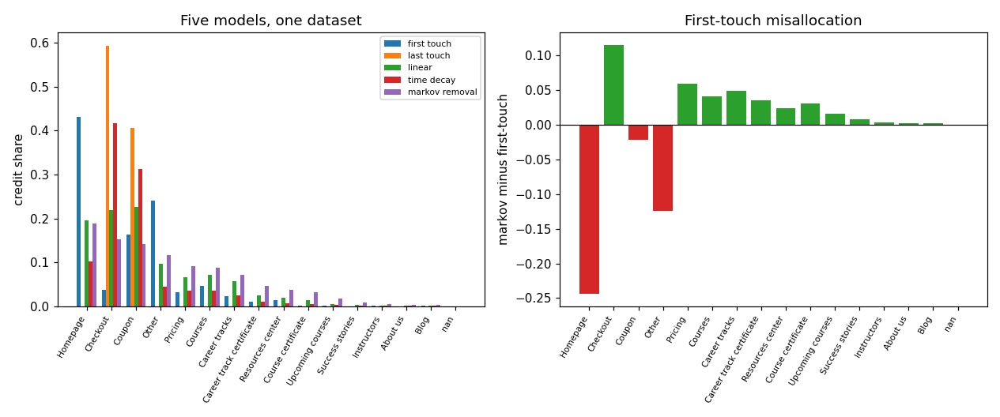

# Marketing Attribution Modelling

Markov removal effect against four rule-based models on real session path data.

**Built:** October 2026

## The question

Which touchpoint actually earns credit for a conversion, and by how much do the usual first-touch and last-touch rules disagree with a model that measures what happens when a step is removed?

## Data

- **Published user journey dataset** - 1,350 sessions, 898 distinct paths, 16 distinct steps
- Source: nikhilchoudhary28/user-journey-analysis, GitHub (public repository; provenance of the underlying sessions is not documented)
- Touchpoints are ON-SITE page steps (Homepage, Pricing, Courses, Checkout, Coupon), not paid-media channels. Conversion means a path ending on a terminal value step.

## Method

- Path parsing into transition counts over START, page steps and absorbing states
- Absorption probability solved exactly as a linear system, no recursion or simulation
- Removal effect per step, renormalised to a credit share
- Compared against first-touch, last-touch, linear and time-decay

## Results

| Metric | Value |
|---|---|
| sessions | 1350 |
| unique_paths | 898 |
| converted_sessions | 1193 |
| conversion_rate | 0.8837 |
| distinct_steps | 16 |
| absorption_prob_baseline | 0.8837 |
| top_step_by_removal_effect | Homepage |
| first_touch_vs_markov_total_variation | 0.3890 |
| time_decay_vs_markov_total_variation | 0.4354 |
| touchpoint_granularity | on-site page steps, not media channels |

### Credit share by model (each column sums to 1)

| step | first touch | last touch | linear | time decay | markov removal |
|---|---|---|---|---|---|
| Homepage | 0.4317 | 0 | 0.1948 | 0.1025 | 0.1879 |
| Checkout | 0.0369 | 0.5943 | 0.2188 | 0.4162 | 0.1525 |
| Coupon | 0.1626 | 0.4057 | 0.226 | 0.3133 | 0.1416 |
| Other | 0.2414 | 0 | 0.097 | 0.0451 | 0.1173 |
| Pricing | 0.031 | 0 | 0.0664 | 0.0352 | 0.0909 |
| Courses | 0.0469 | 0 | 0.071 | 0.0347 | 0.0882 |
| Career tracks | 0.0226 | 0 | 0.057 | 0.0254 | 0.0719 |
| Career track certificate | 0.0101 | 0 | 0.0251 | 0.0096 | 0.0457 |
| Resources center | 0.0134 | 0 | 0.0198 | 0.0072 | 0.038 |
| Course certificate | 0.0008 | 0 | 0.0129 | 0.0055 | 0.0313 |
| Upcoming courses | 0.0008 | 0 | 0.0052 | 0.0021 | 0.0167 |
| Success stories | 0 | 0 | 0.0024 | 0.0016 | 0.0077 |
| Instructors | 0.0008 | 0 | 0.0015 | 0.0006 | 0.0045 |
| About us | 0 | 0 | 0.0008 | 0.0005 | 0.003 |
| Blog | 0.0008 | 0 | 0.0012 | 0.0006 | 0.0028 |
| nan | 0 | 0 | 0 | 0 | 0.0 |



*The models disagree, and the disagreement is the finding*

## What the numbers mean

All five models spread credit differently, and the disagreement is the whole reason attribution exists: first-touch and the Markov ranking differ by a total-variation distance near 0.39, so a third of the credit sits in the wrong place under the naive rule. Because this file has 88 percent conversion, removal effects are compressed relative to a real media export, which is a limitation of the data rather than of the method.

## Limitations

Nearly every session converts, so credit allocation matters less here than in a normal funnel; treat this as a working pipeline over a thin sample. Session-level data with no spend, no revenue and no user identity beyond an index. Provenance of the paths is undocumented, so the absolute numbers are not auditable.

## Run it

    pip install -r requirements.txt
    python src/main.py

```
python src/main.py            # requires the dataset in data/ (see data/README.md)
```

## License

MIT
